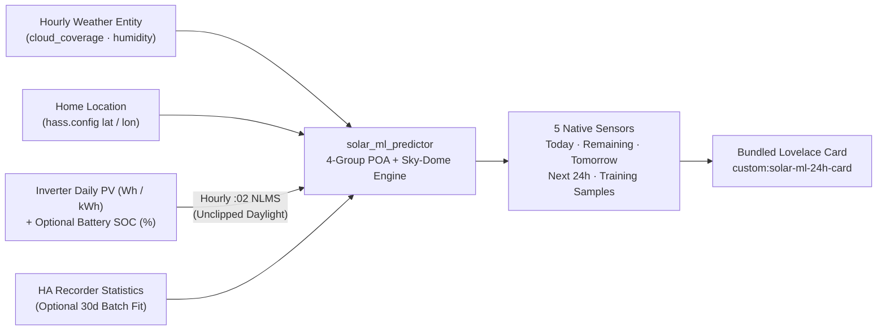

# Solar ML Multi-Group PV Predictor (`solar_ml_predictor`)

A standalone, zero-dependency **Home Assistant Custom Integration** (for the Home Assistant Marketplace / HACS) — evolved as a structured Home Assistant reimplementation of my old Domoticz weather/solar predictor — that predicts hourly, same-day, next-day, and rolling 24-hour photovoltaic (PV) solar energy production across **up to 4 solar panel groups** (roof planes / MPPT strings) using a **Physics-Informed Self-Learning Regression Engine**.

Unlike purely theoretical clear-sky services that systematically over- or under-predict due to local horizon shading, panel aging, microclimate haze, or multi-plane roof limits, `solar_ml_predictor` learns your installation's real-world MPPT behavior directly from Home Assistant—while automatically excluding zero-export battery-full clipping and inverter AC saturation hours.

---

## Key Features

### 1. Up to 4 Independent Solar Panel Groups (UI Configurable)
Configure **1 to 4 solar panel groups** directly from **Settings → Devices & Services** (or adjust them anytime via **Configure**):
- **Per-Group Geometry**: Name, Installed Peak Power (`kWp`), Roof Tilt / Declination (`0°–90°`), and Compass Azimuth (`0°–360°`, where `0° = N`, `90° = E`, `180° = S`, `270° = W`).
- **Seamless Array Expansion**: Panel groups are normalized internally against a canonical `8.50 kWp` reference unit ($P_{\text{ref}} = 8.50\text{ kWp}$). Adding a second, third, or fourth panel string—or changing `kWp` capacity—immediately scales both direct Plane-of-Array ($\cos\theta_i$) beam irradiance and sky-dome diffuse irradiance **without discarding previously learned model weights or resetting training history**.

### 2. Zero-Overhead Online Self-Learning (Normalized LMS) + Recorder Batch Retrain


- **Hourly `:02` Online Normalized LMS**: At `:02` past each hour, if the just-completed hour had sun above the horizon ($\text{el} > 3^\circ$), valid inverter telemetry, no zero-export battery clipping ($\text{SOC}_{\text{start}} < \text{SOC}_{\text{clip}}$ and $\text{SOC}_{\text{end}} < \text{SOC}_{\text{clip}}$), and no inverter AC saturation ($y_{\text{actual}} < P_{\text{inv,AC}} - 0.2\text{ kWh}$), weights update in `< 1 ms` CPU with a rolling memory window of **`4,400` daylight hours** (~1 full year across all 4 seasons).
- **One-Click Recorder Batch Fit**: Press the built-in **`Retrain from Recorder`** button (or call `solar_ml_predictor.retrain_from_recorder`) to fit L2-regularized Ridge weights directly on 30–365 days of Home Assistant Long-Term Statistics (`recorder`).
- **Zero External Python Dependencies**: Uses a built-in pure-Python $4\times 4$ partial-pivoting Ridge solver (`requirements: []`), so it installs instantaneously on Home Assistant OS, Green, Yellow, Container, and Core.

### 3. Bundled 24-Hour Hourly Bar-Chart Card (`custom:solar-ml-24h-card`)
Ships with a lightweight (`~15 KB`), zero-dependency Web Component served automatically at `/solar_ml_predictor/solar-ml-24h-card.js`:
- Matches Home Assistant's native **Energy Solar** bar-chart aesthetic (top-rounded translucent amber bars with `#ff9800` stroke, auto-scaled `kWh` Y-axis, 4-hour X-axis ticks, bold midnight date boundary, and top-right 24h total `kWh` pill).
- Uses `ResizeObserver` 1:1 pixel SVG coordinates so text and bar corners remain crisp across mobile phones, wall tablets, and wide desktop columns, with hover/tap hourly inspection.

---

## Physics-Informed Multi-Group Model

Let active panel groups $g \in \{1, \dots, G\}$ ($1 \le G \le 4$) have DC peak power $P_g$ ($\text{kWp}$), roof tilt $\beta_g$, and azimuth $\gamma_g$, normalized to the canonical reference capacity $P_{\text{ref}} = 8.50\text{ kWp}$ via $s_g = P_g / P_{\text{ref}}$.

For each daylight hour $h$ ($\text{el}_h > 0^\circ$), solar position $(\text{el}_h, \text{az}_h)$ is computed from Home Assistant's configured latitude and longitude at the midpoint of the hour. Each group's Plane-of-Array angle-of-incidence cosine is:

$$\text{poa}_{g,h} = \max\Big(0,\ \sin(\text{el}_h)\cos(\beta_g) + \cos(\text{el}_h)\sin(\beta_g)\cos(\text{az}_h - \gamma_g)\Big)$$

Summing across all active groups yields the effective direct-beam POA factor $\text{poa}_{\text{eff},h}$ and isotropic sky-dome diffuse factor $\text{sky}_{\text{eff}}$:

$$\text{poa}_{\text{eff},h} = \sum_{g=1}^{G} s_g \cdot \text{poa}_{g,h}, \qquad \text{sky}_{\text{eff}} = \sum_{g=1}^{G} s_g \cdot \frac{1 + \cos(\beta_g)}{1 + \cos(45^\circ)}$$

With $\text{clear}_h = 1 - \frac{\text{clouds}_h}{100}$ and $\text{dry}_h = \max\left(0,\ 1 - \frac{\text{humidity}_h}{100}\right)$, predicted hourly energy (in $\text{kWh}$, bounded by the inverter's rated AC limit $P_{\text{inv,AC}}$) is:

$$\hat{y}_h = \min\Big(P_{\text{inv,AC}},\ \max\big(0,\ w_0 \cdot \text{poa}_{\text{eff},h} \cdot \text{clear}_h^2 + w_1 \cdot \text{sky}_{\text{eff}} \cdot \sin(\text{el}_h) \cdot \text{clear}_h^2 + w_2 \cdot \text{poa}_{\text{eff},h} \cdot \text{dry}_h + w_3 \cdot \text{sky}_{\text{eff}} \cdot \sin(\text{el}_h) \cdot (0.25 + 0.75 \cdot \text{clear}_h)\big)\Big)$$

Online updates apply Normalized LMS with weak L2 prior anchoring toward $\mathbf{w}_{\text{prior}} = [1.6201, -0.4649, 1.8363, 4.4914]$ (calibrated on the $8.50\text{ kWp}$ reference scale):

$$n_{\text{new}} = \min(N_{\max},\ n + 1), \qquad \eta = \frac{1}{n_{\text{new}} (1 + \|\mathbf{x}_h\|^2)}, \qquad \mathbf{w} \leftarrow \mathbf{w} + \eta\Big((y_h - \hat{y}_h)\mathbf{x}_h - 0.01(\mathbf{w} - \mathbf{w}_{\text{prior}})\Big)$$

---

## Installation via Home Assistant Marketplace / HACS

1. Open **HACS** (or **Settings → Marketplace** on HA 2026.11+) → **Custom repositories**.
2. Add `https://github.com/cpetra/ha-solar-ml-predictor` with Category: **Integration**.
3. Install **Solar ML Predictor** and restart Home Assistant.
4. Go to **Settings → Devices & Services → Add Integration → Solar ML Predictor** and configure:
   - **Hourly Weather Entity** (`weather.*`, e.g., OpenWeatherMap v3.0, Met.no, PirateWeather)
   - **Daily PV Generation Sensor** (`sensor.*` reporting daily energy in `Wh`, `kWh`, or `MWh`)
   - **Battery SOC Sensor (%)** *(optional — enables automatic zero-export battery-clipping exclusion)*
   - **Live Cloud Coverage & Humidity Sensors** *(optional — falls back to attributes on the weather entity)*
   - **Inverter Rated AC Power Limit (`kW`)** & **Battery Clipping Threshold (`%`)**
   - **Up to 4 Solar Panel Groups** (set `Installed Peak Power` to `0 kWp` on unused groups)

### Registering the 24h Prediction Graph Card
Add `/solar_ml_predictor/solar-ml-24h-card.js` as a Dashboard Resource (**Settings → Dashboards → Resources → Add Resource**, Type: **JavaScript Module**), then add the card to any view:

```yaml
type: custom:solar-ml-24h-card
entity: sensor.solar_ml_predictor_forecast_next_24h
title: Solar Prediction (24h)
grid_options:
  columns: 12
  rows: 4
```

---

## Entities & Services

### Entities Created
| Platform | Entity | Unit / Class | Description |
| :--- | :--- | :--- | :--- |
| `sensor` | `sensor.*_forecast_today` | `kWh` (`energy`, `total`) | Full-day projected PV generation (`Produced today + Remaining today`) |
| `sensor` | `sensor.*_forecast_remaining_today` | `kWh` (`energy`, `total`) | Remaining daylight PV forecast for today ( active hour prorated) |
| `sensor` | `sensor.*_forecast_tomorrow` | `kWh` (`energy`, `total`) | Full-day PV forecast for tomorrow |
| `sensor` | `sensor.*_forecast_next_24h` | `kWh` (`energy`, `total`) | Rolling next-24-hours PV total + `series_compact` & `hourly_forecast` attributes |
| `sensor` | `sensor.*_training_samples` | `samples` (`diagnostic`) | Learned unclipped daylight hours + `weights`, `l2_drift_from_prior`, and `panel_groups` |
| `button` | `button.*_refresh_forecast` | `config` | Re-fetches hourly weather forecast and updates predictions immediately |
| `button` | `button.*_retrain_from_recorder` | `config` | Batch-fits Ridge weights from 30 days of Recorder hourly statistics |

### Services
- `solar_ml_predictor.refresh_forecast`: Trigger an immediate forecast evaluation.
- `solar_ml_predictor.retrain_from_recorder`: Batch-fit weights from `days` (`3–365`, default `30`) of Recorder hourly statistics.
- `solar_ml_predictor.set_model_state`: Seed or migrate `weights` (`[w0, w1, w2, w3]` on the `8.50 kWp` reference scale) and `samples` (`n`).

---

## Repository Structure

```text
ha-solar-ml-predictor/
├── .github/
│   └── workflows/
│       └── validate.yaml                              # GitHub Actions: hassfest + HACS validation
├── custom_components/
│   └── solar_ml_predictor/
│       ├── __init__.py                                # Setup, static card hosting & domain services
│       ├── button.py                                  # Refresh Forecast & Retrain from Recorder buttons
│       ├── config_flow.py                             # UI Config Flow & Options Flow (1–4 panel groups)
│       ├── const.py                                   # Constants & 8.50 kWp reference prior weights
│       ├── coordinator.py                             # Online NLMS learner, storage & Recorder retrainer
│       ├── frontend/
│       │   └── solar-ml-24h-card.js                   # Custom 24h bar-chart Web Component
│       ├── manifest.json                              # Home Assistant integration manifest (v1.0.0)
│       ├── ml_engine.py                               # Pure-Python solar geometry, NLMS & 4x4 Ridge solver
│       ├── sensor.py                                  # Today, Remaining, Tomorrow, Next-24h & Samples sensors
│       ├── services.yaml                              # Service schemas & UI selectors
│       ├── strings.json                               # UI strings
│       └── translations/
│           └── en.json                                # English UI translations
├── .gitignore
├── hacs.json                                          # HACS / Marketplace metadata
├── LICENSE                                            # MIT License
├── README.md
└── solar_ml.py                                        # Offline CLI cross-validation & Recorder audit utility
```
