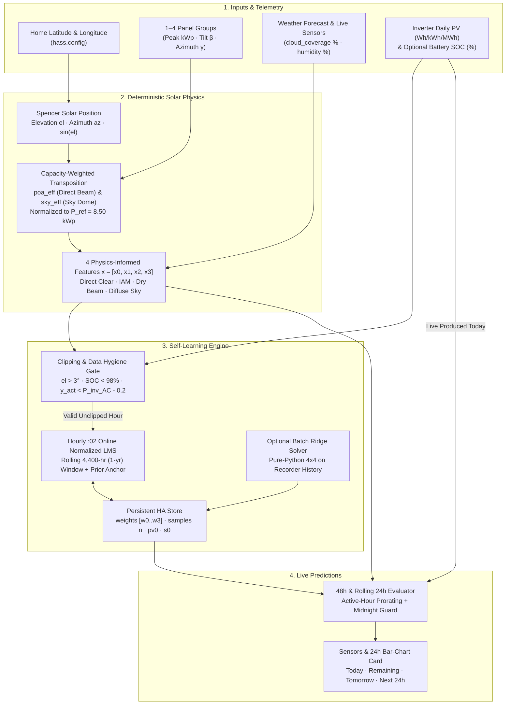

# Solar ML Multi-Group PV Predictor (`solar_ml_predictor`)

A standalone, zero-dependency **Home Assistant Custom Integration** (for the Home Assistant Marketplace / HACS) — evolved as a structured Home Assistant reimplementation of my old Domoticz weather/solar predictor — that predicts hourly, same-day, next-day, and rolling 24-hour photovoltaic (PV) solar energy production across **up to 4 solar panel groups** (roof planes / MPPT strings) using a **Physics-Informed Self-Learning Regression Engine**.

Unlike purely theoretical clear-sky services that systematically over- or under-predict due to local horizon shading, panel aging, microclimate haze, or multi-plane roof geometry, `solar_ml_predictor` learns your installation's real-world MPPT behavior directly from Home Assistant—while automatically excluding zero-export battery-full clipping and inverter AC saturation hours.

---

## Table of Contents

1. [Key Capabilities](#key-capabilities)
2. [Installation & Configuration Guide](#installation--configuration-guide)
   - [Prerequisites](#1-prerequisites)
   - [Install via Home Assistant Marketplace or HACS](#2-install-via-home-assistant-marketplace-or-hacs)
   - [Manual Installation](#3-manual-installation)
   - [Step-by-Step UI Configuration](#4-step-by-step-ui-configuration)
   - [Configuring Up to 4 Solar Panel Groups (Examples)](#5-configuring-up-to-4-solar-panel-groups-examples)
   - [Initial Calibration & Adding Panels Later](#6-initial-calibration--adding-panels-later)
   - [Adding the 24-Hour Prediction Graph Card](#7-adding-the-24-hour-prediction-graph-card)
3. [How the Machine Learning Engine Works](#how-the-machine-learning-engine-works)
   - [Why Physics-Informed ML Beats Pure Physics & Black-Box Models](#1-why-physics-informed-ml-beats-pure-physics--black-box-models)
   - [Solar Position Astronomy](#2-solar-position-astronomy)
   - [Multi-Group POA & Sky-Dome Transposition (`8.50 kWp` Reference Scale)](#3-multi-group-poa--sky-dome-transposition-850-kwp-reference-scale)
   - [The 4 Physical Features & the `uv_index` Skew Trap](#4-the-4-physical-features--the-uv_index-skew-trap)
   - [Automatic Data Hygiene & Hardware Clipping Guards](#5-automatic-data-hygiene--hardware-clipping-guards)
   - [Dual Learning Modes: Hourly Online NLMS & Batch Ridge Regression](#6-dual-learning-modes-hourly-online-nlms--batch-ridge-regression)
   - [Intra-Hour Slot Prorating & Real-Time Evaluation](#7-intra-hour-slot-prorating--real-time-evaluation)
4. [Entities & Services Reference](#entities--services-reference)
5. [Repository Structure](#repository-structure)

---

## Key Capabilities

- **Up to 4 Independent Solar Panel Groups**: Configure 1 to 4 roof planes / MPPT strings (`Name`, `Peak kWp`, `Roof Tilt`, `Compass Azimuth`) directly in the Home Assistant UI—ideal for single-slope roofs, East–West / ENE–WSW split gable roofs, or multi-building setups (roof + garage + pergola).
- **Seamless Array Expansion**: All groups are normalized internally against a canonical `8.50 kWp` reference unit (`P_ref = 8.50 kWp`). Adding new panels or enabling a 2nd/3rd/4th group immediately scales predictions without losing previously learned weights or resetting sample history.
- **Zero-Overhead Online Self-Learning + One-Click Recorder Bootstrap**: Updates weights at `:02` every daylight hour (`< 1 ms` CPU, `< 100` bytes storage, `4,400`-hour / 1-year rolling memory) and includes a 1-click **`Retrain from Recorder`** button to fit 30–365 days of historical Home Assistant Long-Term Statistics in `< 50 ms`.
- **Zero External Python Dependencies (`requirements: []`)**: Implements solar astronomy, Normalized LMS, and a `4×4` partial-pivoting Ridge solver in pure Python—installing instantly on Home Assistant OS, Green, Yellow, Container, and Core.
- **Bundled 24-Hour Bar-Chart Card (`custom:solar-ml-24h-card`)**: Auto-hosted Web Component matching Home Assistant's native **Energy Solar** bar chart, with `ResizeObserver` 1:1 pixel-sharp SVG rendering and hover/tap hourly inspection.

---

## Installation & Configuration Guide

### 1. Prerequisites

Before adding the integration, verify the following in your Home Assistant instance:

1. **Home Coordinates (`Settings → System → General`)**: Make sure your Home zone pin (latitude, longitude, and timezone) is set accurately—the integration reads `hass.config.latitude` and `hass.config.longitude` automatically for solar geometry.
2. **Hourly Weather Entity (`weather.*`)**: Any weather integration that supports hourly forecasts via `weather.get_forecasts(type="hourly")` and provides `cloud_coverage` (`%`) and `humidity` (`%`) per slot (e.g., **OpenWeatherMap v3.0**, **Met.no**, **PirateWeather**, **AccuWeather**).
3. **Daily PV Generation Sensor (`sensor.*`)**: Your solar inverter's cumulative daily PV energy sensor (in `Wh`, `kWh`, or `MWh`—unit conversion is automatic) that increments during daylight and resets around midnight.
4. **Optional Battery SOC Sensor (`sensor.*`, `%`)**: Recommended for hybrid inverters operating in **zero-export** mode (`ZERO_EXPORT_TO_CT` / self-consumption). Once a battery reaches `98–100%`, zero-export inverters throttle PV power down to house load; providing your battery SOC sensor lets the ML learner automatically ignore throttled hours.

---

### 2. Install via Home Assistant Marketplace or HACS

#### On Home Assistant `2026.11+` (Built-in Marketplace)
1. Go to **Settings → Marketplace**.
2. Open the **three-dots menu (`⋮`)** in the top-right corner and select **Custom repositories**.
3. Paste `https://github.com/cpetra/ha-solar-ml-predictor` and select Category: **Integration**.
4. Find **Solar ML Multi-Group PV Predictor** in the catalog, click **Install**, and **restart Home Assistant** when prompted.

#### On Classic HACS (`2026.10` and earlier)
1. Open **HACS** in the sidebar → **three-dots menu (`⋮`)** (top right) → **Custom repositories**.
2. Paste `https://github.com/cpetra/ha-solar-ml-predictor`, choose Category: **Integration**, and click **Add**.
3. Click **Download** on **Solar ML Multi-Group PV Predictor**, then **restart Home Assistant**.

---

### 3. Manual Installation

If you do not use HACS or the Marketplace:
1. Download the latest release archive from [GitHub Releases](https://github.com/cpetra/ha-solar-ml-predictor/releases).
2. Copy the `custom_components/solar_ml_predictor` folder into your Home Assistant `/config/custom_components/` directory so `/config/custom_components/solar_ml_predictor/manifest.json` exists.
3. Restart Home Assistant.

---

### 4. Step-by-Step UI Configuration

1. Navigate to **Settings → Devices & Services → Add Integration** (bottom right).
2. Search for **Solar ML Predictor** and select it.
3. Fill in the setup form:

| Field | Required | Default | How to Configure |
| :--- | :---: | :---: | :--- |
| **Hourly Weather Entity** | Yes | — | Pick your `weather.*` entity (must support `hourly` forecasts). |
| **Daily PV Generation Sensor (kWh)** | Yes | — | Pick your inverter's daily solar production sensor (`Wh`, `kWh`, or `MWh`). |
| **Battery State of Charge Sensor (%)** | Optional | Empty | Pick your hybrid inverter's battery SOC `%` sensor (leave empty on grid-tied export systems without curtailment). |
| **Live Cloud Coverage Sensor (%)** | Optional | Empty | Optional dedicated live cloud `%` sensor used at `:02` online learning ticks. If omitted, reads `attributes.cloud_coverage` from the weather entity. |
| **Live Outdoor Humidity Sensor (%)** | Optional | Empty | Optional dedicated outdoor relative humidity `%` sensor. If omitted, reads `attributes.humidity` from the weather entity. |
| **Inverter Rated AC Power Limit (kW)** | Yes | `10.0 kW` | Maximum AC/MPPT output your inverter can deliver (e.g., `5.0`, `8.0`, `10.0`, `15.0 kW`). Caps hourly predictions and excludes AC-saturated hours from distorting weights. |
| **Battery Clipping Exclusion Threshold (%)** | Yes | `98.0 %` | Excludes daylight hours where battery SOC reaches or exceeds this percentage from training (set to `95–98%` if your BMS tapers charge current early). |
| **Rolling Online Memory Window** | Yes | `4400` | Effective online learning memory in unclipped daylight hours (`4,400` hours ≈ 1 full calendar year across all 4 seasons). |
| **Group 1 — Name / Peak Power / Tilt / Azimuth** | Yes | `5.0 kWp`, `45°`, `180°` | Primary solar panel string (`Peak Power > 0 kWp`). Multiply panel count × panel STC rating in kW (e.g., `16 × 0.530 = 8.48 kWp`). |
| **Groups 2–4 — Name / Peak Power / Tilt / Azimuth** | Optional | `0.0 kWp` (Disabled) | Up to 3 additional panel strings on other roof slopes, carports, or facades. Leave **Installed Peak Power** at `0` on any unused group. |

#### Quick Reference for Roof Tilt & Compass Azimuth
- **Roof Tilt / Declination (`0°–90°`)**: `0°` = flat horizontal panels, `10°–15°` = low-pitch carport/ballast mount, `30°–45°` = typical residential pitched roof, `90°` = vertical wall/balcony mount.
- **Compass Azimuth (`0°–360°`, clockwise from True North)**:

| Direction | Azimuth | Direction | Azimuth | Direction | Azimuth | Direction | Azimuth |
| :--- | :---: | :--- | :---: | :--- | :---: | :--- | :---: |
| **N** | `0°` | **E** | `90°` | **S** | `180°` | **W** | `270°` |
| **NNE** | `22°` | **ESE** | `112°` | **SSW** | `202°` | **WNW** | `292°` |
| **NE** | `45°` | **SE** | `135°` | **SW** | `225°` | **NW** | `315°` |
| **ENE** | `68°` | **SSE** | `158°` | **WSW** | `248°` | **NNW** | `338°` |

> [!TIP]
> For two strings mounted on **opposite slopes of a symmetric gable roof**, their azimuths always differ by **`180°`** (for example, `248°` WSW on one slope and `248° - 180° = 68°` ENE on the opposite slope).

---

### 5. Configuring Up to 4 Solar Panel Groups (Examples)

- **Example A — Single South-Facing Array (`6.4 kWp`)**:
  - `Group 1`: Name `South Roof`, Peak `6.40 kWp`, Tilt `35°`, Azimuth `180°`
  - `Groups 2–4`: Peak `0 kWp` (disabled)
- **Example B — Opposing Split-Roof Array (`8.50 kWp` WSW + `4.00 kWp` ENE on a `10 kW` Inverter)**:
  - `Inverter Rated AC Power Limit`: `10.0 kW`
  - `Group 1`: Name `WSW Roof`, Peak `8.50 kWp`, Tilt `45°`, Azimuth `248°`
  - `Group 2`: Name `ENE Roof`, Peak `4.00 kWp` (`8 × 500 W`), Tilt `45°`, Azimuth `68°`
  - `Groups 3–4`: Peak `0 kWp` (disabled)
- **Example C — 4-Group Multi-Aspect Home (`East + South + West + Pergola`)**:
  - `Group 1`: `East Slope` (`4.0 kWp`, `40°`, `90°`)
  - `Group 2`: `South Dormer` (`2.5 kWp`, `25°`, `180°`)
  - `Group 3`: `West Slope` (`4.0 kWp`, `40°`, `270°`)
  - `Group 4`: `South Patio Pergola` (`3.2 kWp`, `10°`, `180°`)

---

### 6. Initial Calibration & Adding Panels Later

- **Works Immediately on Day 1**: Out of the box, the integration starts with physically calibrated prior weights (`w_prior = [1.6201, -0.4649, 1.8363, 4.4914]` on the `8.50 kWp` reference scale) that automatically scale to your configured group capacities—producing realistic hourly and daily `kWh` forecasts from the very first minute.
- **Instant Historical Bootstrap (Optional)**: If your Daily PV and Cloud Coverage sensors already have **3+ days** of history in Home Assistant's `recorder`, open **Settings → Devices & Services → Solar ML Predictor**, click the device, and press **`Retrain from Recorder`** (or run the `solar_ml_predictor.retrain_from_recorder` action with `days: 30`–`90`) to fit custom site weights immediately.
- **Expanding Your Solar Array Later**: Whenever you add panels or connect a new string, go to **Settings → Devices & Services → Solar ML Predictor → Configure** and update the group capacities (or enable Group 2/3/4). Because weights represent yield per canonical `8.50 kWp` reference unit rather than raw system size, **all previously learned weights and training samples carry forward seamlessly**.

---

### 7. Adding the 24-Hour Prediction Graph Card

When the integration loads, it automatically hosts the custom card module at `/solar_ml_predictor/solar-ml-24h-card.js`.

1. Register the resource once in Home Assistant:
   - Go to **Settings → Dashboards → three-dots menu (`⋮`) → Resources → Add Resource**.
   - **URL**: `/solar_ml_predictor/solar-ml-24h-card.js`
   - **Resource Type**: **JavaScript Module**
2. Hard-refresh your browser (`Ctrl+Shift+R`) or reset the frontend cache in the Companion App (**Settings → Companion App → Debugging → Reset frontend cache**).
3. Add a Manual card to any dashboard view:

```yaml
type: custom:solar-ml-24h-card
entity: sensor.solar_ml_predictor_forecast_next_24h
title: Solar Prediction (24h)
navigation_path: /energy          # Optional: tap card header to navigate to a view
grid_options:
  columns: 12
  rows: 4
```

---

## How the Machine Learning Engine Works

### 1. Why Physics-Informed ML Beats Pure Physics & Black-Box Models

Predicting residential PV production sits between two failure modes:

| Approach | Strength | Failure Mode on Real Homes |
| :--- | :--- | :--- |
| **Pure Theoretical Clear-Sky Services** | Knows solar geometry from Day 1; needs no historical data | Blind to local roof/tree horizon shading, panel temperature/soiling, MPPT wiring losses, and systematic bias in your local weather station's cloud cover |
| **Generic Black-Box ML (Trees / Deep Nets on Raw Weather)** | Learns complex empirical correlations given years of data | Overfits severely on short windows (2 weeks of cloudy November data predicts nonsense in sunny June), breaks completely when adding new panels, and learns false "dark sky" weights when zero-export batteries clip at 100% SOC |
| **Physics-Informed Multi-Group Regression + Online NLMS (`solar_ml_predictor`)** | Exact astronomical & Plane-of-Array geometry **plus** continuous empirical calibration | Best of both worlds: **only 4 physically meaningful parameters**, works accurately on Day 1, adapts to your local microclimate and hardware losses, ignores clipped hours, and scales across 1–4 roof planes |



---

### 2. Solar Position Astronomy

For every evaluated hour `h` (at midpoint UTC timestamp `t_mid = t_start + 30 min`), the engine computes exact solar position from Home Assistant's latitude $\phi$ and longitude $\lambda$ using Spencer's Fourier series for fractional year angle $\gamma_{\mathrm{yr}}$ :

1. **Solar Declination** $\delta$ **& Equation of Time** $\mathrm{EoT}$ (minutes): Accounts for Earth's `23.44°` axial tilt and orbital eccentricity across the 365-day year.
2. **True Solar Time** $\mathrm{TST}$ **& Hour Angle** $\omega$ :

$$
\mathrm{TST} = 60 \cdot t_{\mathrm{UTC}} + \mathrm{EoT} + 4\lambda, \qquad \omega = \frac{\mathrm{TST}}{4} - 180^\circ
$$

3. **Solar Elevation** $\mathrm{el}_h$ **& Solar Azimuth** $\mathrm{az}_h$ :

$$
\sin(\mathrm{el}_h) = \sin\phi\sin\delta + \cos\phi\cos\delta\cos\omega
$$

When $\mathrm{el}_h \le 0^\circ$ (sun below the horizon), predicted PV output is identically `0.0 kWh`.

---

### 3. Multi-Group POA & Sky-Dome Transposition (`8.50 kWp` Reference Scale)

On a multi-plane roof, **direct solar beam** and **diffuse sky light** behave completely differently:
- At `09:00 AM` on a clear day, an East-facing string receives strong direct sunlight (`poa_East > 0.7`), while a West-facing string on the opposite side of the ridge is **self-shaded from the direct sun** (`poa_West = 0`).
- Yet that shaded West string still produces power (`~10–25%` of clear-sky midday output, and nearly equal per-kWp output on `100%` overcast days!) because it faces the **isotropic diffuse sky dome**, proportional to its sky view factor $\frac{1 + \cos\beta_g}{2}$.

For each active panel group $g \in \{1, \dots, G\}$ (`1 ≤ G ≤ 4`) with installed peak power $P_g$ (`kWp`), tilt $\beta_g$, and azimuth $\gamma_g$, we normalize capacity against the canonical reference scale $P_{\mathrm{ref}} = 8.50\text{ kWp}$ :

$$
s_g = \frac{P_g}{8.50}
$$

Each group's Plane-of-Array cosine of angle of incidence $\cos\theta_{i,g,h}$ (clamped to `0` when the sun is behind that plane) is:

$$
\mathrm{poa}_{g,h} = \max\Big(0, \sin(\mathrm{el}_h)\cos(\beta_g) + \cos(\mathrm{el}_h)\sin(\beta_g)\cos(\mathrm{az}_h - \gamma_g)\Big)
$$

Summing across all active groups produces two dimensionless multi-group geometry factors:

$$
\mathrm{poa}_{\mathrm{eff},h} = \sum_{g=1}^{G} s_g \cdot \mathrm{poa}_{g,h}, \qquad \mathrm{sky}_{\mathrm{eff}} = \sum_{g=1}^{G} s_g \cdot \frac{1 + \cos(\beta_g)}{1 + \cos(45^\circ)}
$$

**Why normalize to `8.50 kWp`?**
1. **Universal Seed Weights**: Whether your house has a `3.0 kWp` balcony/roof string (`s_1 = 0.353`) or a `25.0 kWp` 4-group array (`∑ s_g = 2.941`), the feature magnitudes scale proportionally while the learned weight vector $\mathbf{w}$ stays `O(1)` (`~0.5–4.5`), keeping the Normalized LMS step-size denominator $1 + \lVert \mathbf{x}_h \rVert^2$ well-conditioned across all array sizes.
2. **Lossless Hardware Upgrades**: Adding a new string in **Configure** updates $s_g$, immediately scaling both direct morning/afternoon POA and sky diffuse yield while preserving your existing learned weights $\mathbf{w}$.

---

### 4. The 4 Physical Features & the `uv_index` Skew Trap

For each daylight hour `h`, cloud clarity and atmospheric dryness in `[0, 1]` are defined as:

$$
\mathrm{clear}_h = 1 - \frac{\mathrm{clouds}_h}{100}, \qquad \mathrm{dry}_h = \max\left(0, 1 - \frac{\mathrm{humidity}_h}{100}\right)
$$

From these, the model constructs the 4-element feature vector:

$$
\mathbf{x}_h = \left[ x_{0,h}, \quad x_{1,h}, \quad x_{2,h}, \quad x_{3,h} \right]^\top
$$

| Feature | Formula | Learned Weight & Physical Role |
| :--- | :--- | :--- |
| $x_{0,h}$ | $\mathrm{poa}_{\mathrm{eff},h} \cdot \mathrm{clear}_h^2$ | **`w0` (`1.6201` prior)** — Primary **direct solar beam** incident on the tilted panel planes, quadratically attenuated by cloud cover. |
| $x_{1,h}$ | $\mathrm{sky}_{\mathrm{eff}} \cdot \sin(\mathrm{el}_h) \cdot \mathrm{clear}_h^2$ | **`w1` (`-0.4649` prior)** — Clear-sky **horizontal / incidence-angle & air-mass correction** balancing low-elevation grazing vs. high-noon beam angles. |
| $x_{2,h}$ | $\mathrm{poa}_{\mathrm{eff},h} \cdot \mathrm{dry}_h$ | **`w2` (`1.8363` prior)** — **Low-humidity / low-haze direct beam transmittance** (distinguishing crisp dry air from humid hazy/foggy boundary layers). |
| $x_{3,h}$ | $\mathrm{sky}_{\mathrm{eff}} \cdot \sin(\mathrm{el}_h) \cdot (0.25 + 0.75 \cdot \mathrm{clear}_h)$ | **`w3` (`4.4914` prior)** — **Isotropic sky diffuse & cloud-transmitted irradiance** (retaining a `25%` diffuse floor under `100%` overcast skies so cloudy winter days remain accurate). |

Predicted hourly energy (in `kWh`) is clamped between `0.0` and the inverter's rated AC ceiling $P_{\mathrm{inv,AC}}$ :

$$
\hat{y}_h = \min\Big(P_{\mathrm{inv,AC}}, \max\big(0, \mathbf{w}^\top \mathbf{x}_h\big)\Big)
$$

> [!IMPORTANT]
> **Why `uv_index` Is Deliberately Excluded (Train/Serve Skew Prevention):**
> Many weather integrations scale their *live/historical* `uv_index` sensor down by current cloud cover, **but return unattenuated clear-sky `uv_index` inside `weather.get_forecasts(type="hourly")` even when forecasted `cloud_coverage` is `100%`**. Training a regression model on historical `uv_index` and evaluating it on forecasted `uv_index` causes `200%–300%` over-predictions on overcast days. Using only astronomical geometry (`poa_eff`, `sin_el`), `cloud_coverage`, and `humidity` guarantees **100% feature parity** between historical training and 48-hour forecasting.

---

### 5. Automatic Data Hygiene & Hardware Clipping Guards

Real-world solar inverters exhibit non-meteorological curtailment that ruins naive ML learners if left unfiltered. Before accepting any completed hour into online learning (or batch Recorder training), `solar_ml_predictor` enforces **five strict hygiene gates**:

1. **Dual-Endpoint Battery Clipping Guard (`ZERO_EXPORT_TO_CT`)**:
   - Records start-of-hour battery SOC (`s0`) and compares both `s0 < clip_soc_threshold` and end-of-hour `soc_now < clip_soc_threshold` (default `98.0%`). If the battery touched full charge at either boundary (or `soc_max >= 98%` in Recorder history), the hour is skipped so battery-throttled afternoon PV never drags clear-sky weights downward.
2. **Inverter AC Saturation Guard**:
   - When total DC panel kWp exceeds the inverter's AC limit (for example, `13 kWp` of East+West panels on a `10 kW` inverter), rare cold broken-cloud solar noon peaks can hit the `10 kW` ceiling. Hours with $y_{\mathrm{actual}} \ge P_{\mathrm{inv,AC}} - 0.2\text{ kWh}$ are skipped from weight updates while predictions remain cleanly bounded by $\min(P_{\mathrm{inv,AC}}, \dots)$.
3. **Horizon Grazing Filter (`el > 3.0°`)**:
   - Online learning updates only when mid-hour solar elevation exceeds `3.0°`, avoiding noisy dawn/dusk inverter wakeup thresholds and partial-sunset minutes.
4. **Cloud-Inverter Outage Re-Anchoring (`pv0 = -1.0`)**:
   - Cloud-polled inverter integrations occasionally go `unavailable` for 1–2 hours and then jump forward by the cumulative multi-hour energy produced offline. Whenever the PV sensor is unavailable at `:02`, the learner sets `pv0 = -1.0`, causing the next recovery hour to re-anchor `pv0 = pv_now` cleanly rather than misinterpreting a 3-hour catch-up delta as a 1-hour superpower spike.
5. **Midnight Daily-Reset Lag Guard (`00:00–00:59`)**:
   - Many cloud inverters reset their "Daily PV" counter at `00:04–00:10` rather than `00:00:00`. Forcing `pv_now = 0.0` during local hour `0` prevents yesterday's final total from spiking `Forecast Today` at `00:02`.

---

### 6. Dual Learning Modes: Hourly Online NLMS & Batch Ridge Regression

#### A. Hourly `:02` Online Normalized LMS (Continuous Self-Adaptation)
At `:02` past every hour, for each valid unclipped daylight hour with actual production `y_actual = PV_now - pv_0` ($y_{h-1}$) and prior prediction $\hat{y}_{h-1}$ :

$$
n_{\mathrm{new}} = \min(N_{\max}, n + 1), \qquad \eta = \frac{1}{n_{\mathrm{new}} \big(1 + \lVert \mathbf{x}_{h-1} \rVert^2\big)}
$$

$$
\mathbf{w} \leftarrow \mathrm{round}_6\Big(\mathbf{w} + \eta\big((y_{h-1} - \hat{y}_{h-1})\mathbf{x}_{h-1} - 0.01(\mathbf{w} - \mathbf{w}_{\mathrm{prior}})\big)\Big)
$$

- **Self-Normalized Step Size**: Dividing by $1 + \lVert \mathbf{x}_{h-1} \rVert^2$ bounds gradient steps regardless of array capacity or solar noon intensity, guaranteeing Lyapunov stability without hyperparameter tuning.
- **Rolling 1-Year Seasonal Memory (`N_max = 4,400`)**: Across temperate latitudes, a full calendar year contains `~4,380` daylight hours. Capping $n_{\mathrm{new}}$ at `4,400` transitions the learner smoothly from a `1 / n` expanding average in Year 1 into a constant-horizon 1-year exponential moving window—so winter cloudy months never erase summer clear-sky calibration, while multi-year panel degradation (`~0.4%/yr`) is tracked automatically.
- **Weak Prior Anchoring (`0.01 * eta`) & 6-Decimal Precision**: Gentle shrinkage toward $\mathbf{w}_{\mathrm{prior}}$ prevents collinear weight drift during prolonged overcast spells, while `round(6)` precision prevents floating-point quantization underflow even at `n = 4,400`.

#### B. Pure-Python `4×4` Batch Ridge Regression (`Retrain from Recorder`)
When triggered via the **`Retrain from Recorder`** button or `solar_ml_predictor.retrain_from_recorder`, the coordinator queries Home Assistant's `recorder` hourly statistics (`change` for daily PV, `max`/`mean` for SOC, `mean` for clouds and humidity), filters out missing-target (`change == null`) and clipped hours, and solves the closed-form prior-centered Tikhonov / Ridge normal equations (`α = 0.15`) via partial-pivoting Gaussian elimination:

$$
\big(\mathbf{X}^\top \mathbf{X} + \alpha \mathbf{I}_4\big)\mathbf{w} = \mathbf{X}^\top \mathbf{y} + \alpha \mathbf{w}_{\mathrm{prior}}
$$

---

### 7. Intra-Hour Slot Prorating & Real-Time Evaluation

Weather integrations cache hourly forecast arrays whose first slot often begins at the start of the current hour (`HH:00`) or even the previous hour. Naively summing all forecast slots for "today" and adding `Produced Today` double-counts energy already generated during the current hour—creating a classic afternoon "sawtooth" overshoot.

`solar_ml_predictor` eliminates intra-hour double-counting cleanly:
1. Any cached weather slot with `slot_end <= t_now` is discarded.
2. For `Forecast Remaining Today`, the active in-progress hour (`slot_start <= t_now < slot_end`) is scaled by its remaining fraction:

$$
f_{\mathrm{rem}} = \min\left(1.0, \frac{t_{\mathrm{end}} - t_{\mathrm{now}}}{3600}\right)
$$

3. Whenever your inverter's `Daily PV` sensor ticks upward mid-hour, `Forecast Today = Produced Today + Forecast Remaining Today` updates instantaneously from cached slots without re-polling the weather API.
4. Meanwhile, `Forecast Next 24h` outputs the 24 consecutive hourly bar heights starting from the current hour (`series_compact` & `hourly_forecast` attributes) so the 24-hour bar chart displays smooth, un-truncated hourly `kWh` bars.

---

## Entities & Services Reference

### Entities Created

All entities are grouped under a single **Solar ML Predictor** service device and restore learned state across Home Assistant restarts:

| Platform | Entity | Unit / Class | Description |
| :--- | :--- | :--- | :--- |
| `sensor` | `sensor.*_forecast_today` | `kWh` (`energy`, `total`) | Full-day projected PV generation (`Produced today + Remaining today`) |
| `sensor` | `sensor.*_forecast_remaining_today` | `kWh` (`energy`, `total`) | Prorated PV forecast for the remaining daylight hours of today |
| `sensor` | `sensor.*_forecast_tomorrow` | `kWh` (`energy`, `total`) | Full-day PV forecast across all daylight hours of tomorrow |
| `sensor` | `sensor.*_forecast_next_24h` | `kWh` (`energy`, `total`) | Rolling next-24-hours PV total + `series_compact` & `hourly_forecast` attributes for `custom:solar-ml-24h-card` |
| `sensor` | `sensor.*_training_samples` | `samples` (`diagnostic`) | Learned unclipped daylight hours (`n`), plus `weights`, `l2_drift_from_prior`, `pv0_kwh`, `s0_soc`, and active `panel_groups` |
| `button` | `button.*_refresh_forecast` | `config` | Immediately fetches fresh hourly weather forecasts and recomputes all sensors |
| `button` | `button.*_retrain_from_recorder` | `config` | Batch-fits Ridge weights from the last 30 days of Recorder hourly statistics |

### Actions (Services)

- **`solar_ml_predictor.refresh_forecast`**:
  - Optional `entry_id`: Re-fetches hourly weather forecasts and refreshes predictions without altering weights.
- **`solar_ml_predictor.retrain_from_recorder`**:
  - Optional `days` (`3–365`, default `30`), `entry_id`: Runs batch Ridge regression on Home Assistant `recorder` hourly Long-Term Statistics.
- **`solar_ml_predictor.set_model_state`**:
  - Required `weights` (`[w0, w1, w2, w3]` on the `8.50 kWp` reference scale) and `samples` (`1–8800`), optional `entry_id`: Seeds or migrates learned weights from an existing setup.

---

## Repository Structure

```text
ha-solar-ml-predictor/
├── .github/
│   └── workflows/
│       └── validate.yaml                              # GitHub Actions: hassfest + HACS validation
├── custom_components/
│   └── solar_ml_predictor/
│       ├── __init__.py                                # Setup, static card hosting & domain services
│       ├── button.py                                  # Refresh Forecast & Retrain from Recorder buttons
│       ├── config_flow.py                             # UI Config Flow & Options Flow (1–4 panel groups)
│       ├── const.py                                   # Constants & 8.50 kWp reference prior weights
│       ├── coordinator.py                             # Online NLMS learner, storage & Recorder retrainer
│       ├── frontend/
│       │   └── solar-ml-24h-card.js                   # Custom 24h bar-chart Web Component
│       ├── manifest.json                              # Home Assistant integration manifest (v1.0.0)
│       ├── ml_engine.py                               # Pure-Python solar geometry, NLMS & 4x4 Ridge solver
│       ├── sensor.py                                  # Today, Remaining, Tomorrow, Next-24h & Samples sensors
│       ├── services.yaml                              # Service schemas & UI selectors
│       ├── strings.json                               # UI strings
│       └── translations/
│           └── en.json                                # English UI translations
├── .gitignore
├── hacs.json                                          # HACS / Marketplace metadata
├── LICENSE                                            # MIT License
├── README.md
└── solar_ml.py                                        # Offline CLI cross-validation & Recorder audit utility
```
